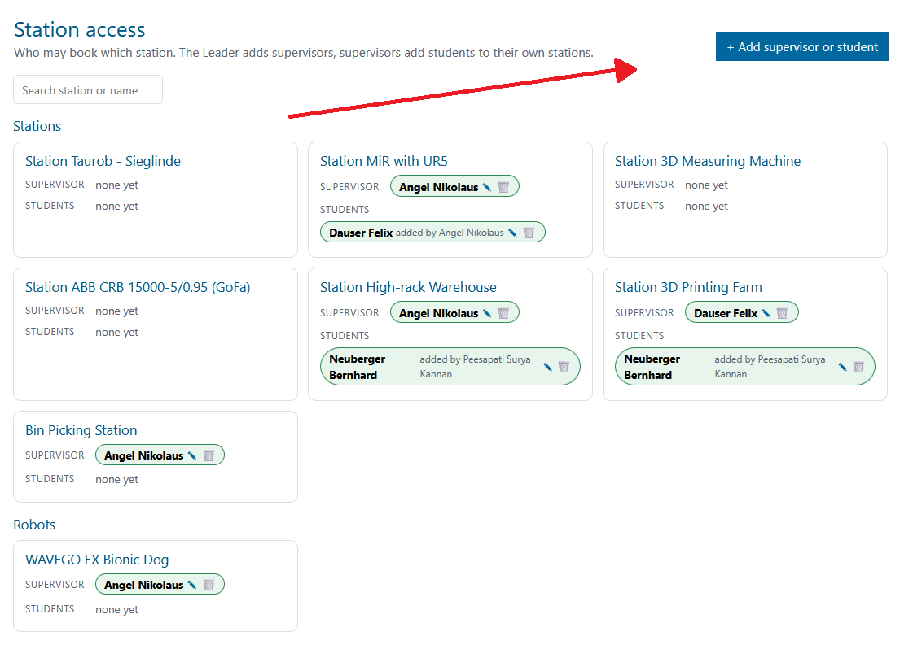
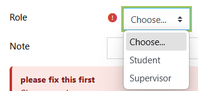
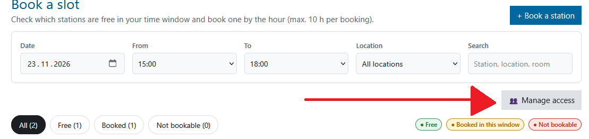
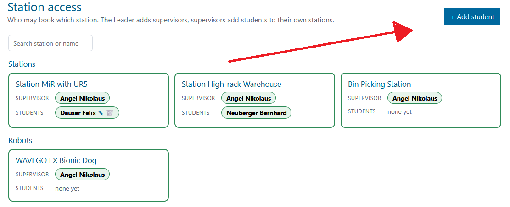
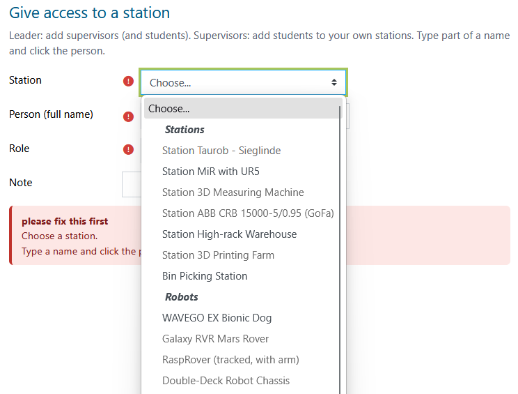
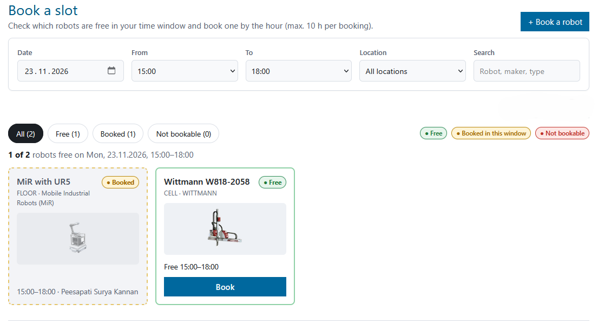
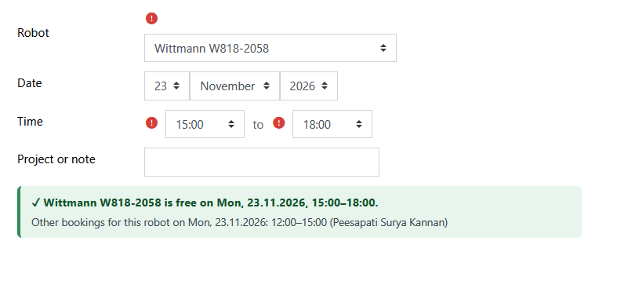
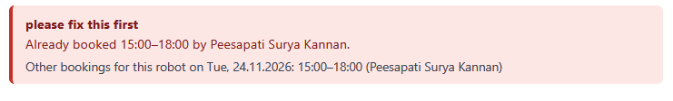
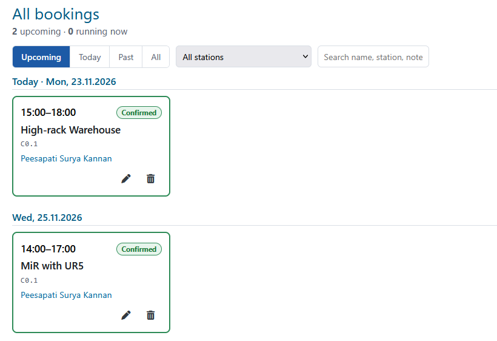

# Digital Factory Lab – How to book robots and stations

This guide is for everyone who uses the lab booking pages in Moodle: **Leader**, **Supervisors** and **Students**.

You will find three modules in the Moodle course:

| Module | Used for |
|---|---|
| **Robot Bookings** | Book a robot by the hour |
| **Station bookings** | Book a station by the hour |
| **Station access** (via 👥 *Manage access*) | Decide who may book which robot or station |

**How access works:**

```
Leader  ──adds──►  Supervisor of a robot/station  ──adds──►  Students
```

You can only book a robot or station after you have been added to it. Some robots belong to a station (e.g. *MiR with UR5*, *Wittmann W818-2058* → *3D Printing Farm*). Booking one blocks the other for the same time, so nobody can double-book.

**Booking rules:** Monday–Friday, 08:00–18:00, whole hours, max. **10 hours** per booking.

## Part 1 – Leader

You manage the whole system and see and book everything.

### 1.1 Add a Supervisor / Student
1. Open **Station access** (or **👥 Manage access** on a booking page).
2. Click **+ Add supervisor or student**.

    


3. **Station:** choose the robot or station. They are grouped into *Stations* and *Robots*.
4. **Person:** type part of the name and **click the person in the list**.
5. **Role:** **Supervisor**.
6. Click **Save**. The supervisor can now add their own students.

    


You can also add **students** anywhere yourself, using the same steps with Role: Student.

### 1.2 Remove a supervisor
Click **🗑 Remove** next to the supervisor. Students they added stop counting for that robot/station. Re-add them under the new supervisor if needed.

### 1.3 Check what others see
If the preview switch is on, use **View as** on the Station access page. Type a name to see the page as that supervisor or student. Switch back with **Stop preview**.

### 1.4 Good to know
- Only entries written by the right person count:
  - a Supervisor entry only if the **Leader** added it;
  - a Student entry only if the **Leader** or **that station's supervisor** added it.
- New robots/stations, links and settings are explained in the technical **README.md**.

---

## Part 2 – Supervisors

You were added by the Leader as supervisor of one or more robots/stations. You can book them yourself and you decide which students may book them.

### 2.1 Add a Student
1. Open **Robot Bookings** or **Station bookings** and click **👥 Manage access** (or open **Station access** directly).

    

2. You see only **your** robots/stations, with their supervisors and students.
3. Click **+ Add student**.

    

4. **Station:** choose the robot or station. You can only pick your own.

    

5. **Person:** type part of the name and **click the person in the list**. Don't just type the name; it must be picked from the list.
6. **Role:** Student.
7. Click **Save**. The student can book straight away.

> The student must be **enrolled in the Moodle course**. If you can't find a name, the student is not a course participant yet. Ask the course teacher to enrol them.

### 2.2 Remove or change a student
- In **Station access**, click **🗑 Remove** or **✎ Change** next to the student.
- You can only change students **you or the Leader** added to **your** robots/stations. You can't change other supervisors' entries.

### 2.3 Tips
- A linked robot uses the **station's** list (e.g. students on *3D Printing Farm* may also book *Wittmann W818-2058*). Add them once, on the station.
- If a student can't book, check that they are on the list for exactly that robot/station.

---

## Part 3 – Students

### 3.1 Get access
1. Make sure you are **enrolled in the Moodle course**. Only course participants can be added.
2. Ask the **Supervisor** of the robot or station you need to add you. 
3. Once you are added, the robot or station appears on your booking page. You only see what you may book.

### 3.2 Book a robot or station
1. Open **Robot Bookings** or **Station bookings**.
2. At the top, choose the **Date**, **From** and **To** time.
3. The tiles show each robot/station:
   - 🟢 **Free** – available in your time window
   - 🟡 **Booked in this window** – someone already has it (the tile shows the booked times)
   - 🔴 **Not bookable** – lab closed that day, or the robot/station is out of service

    


4. Click **Book** on a free tile. The booking form opens with your date and time already filled in.
5. Optionally write your **project or note**.
6. Cross check the box under the form:
   - **✓ … is free** → click **Save**.

    

- **"please fix this first"** → read the message (time taken, too long, no access …) and change your choice.

    
   

Your Moodle name is saved with the booking automatically.

### 3.3 See, change or cancel your bookings
- Scroll down to **All bookings**. Use the tabs **Upcoming / Today / Past / All**, the dropdown to pick one robot/station, or the search box.

    

- On **your own** booking card:
  - **✎** – change the date, time or note
  - **🗑** – cancel the booking
- Please cancel bookings you don't need, so others can use the time.

### 3.4 What the labels mean
| Label | Meaning |
|---|---|
| **Confirmed** | Your booking is valid |
| **Now** | The booking is running right now |
| **Problem** | Someone booked the same time earlier. The earlier booking wins, so please change yours. |
| *(station booking)* / *(robot booking)* | The time was booked on the linked page (robot ↔ station) |

---

## Quick help

| Problem | What to do |
|---|---|
| "You need to be on its access list" | Ask the supervisor named in the message to add you |
| I can't find a person when adding | They must be enrolled in the Moodle course; type part of the name and click it in the list |
| The time shows as booked but I see no booking | It was booked on the linked robot/station page |
| My booking shows **Problem** | Someone booked earlier; choose another time |
| I can't edit a booking | You can only edit your own bookings |
| Something else | Contact the Leader: Dr. Kannan Peesapati |

---
© Dr. Kannan Peesapati – Digital Factory Lab, FH Technikum Wien
